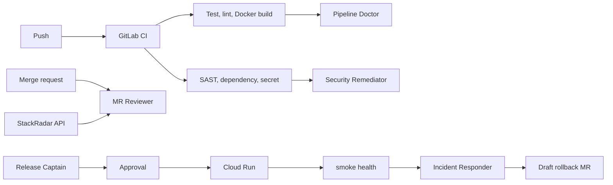

# StackRadar on GitLab Transcend

Path B. The MIT app already scores 31 tools. This branch adds the work that happens after code is written: review, a red pipeline, scanner findings, a gated Cloud Run deploy, and a failed health check.

Deadline on the Devpost page: Oct 27, 2026, 1:00pm UTC.

## The problem

A score can tell you a library is losing momentum. It does not review the merge request that adds it, fix the red job, patch the finding, or roll back a bad deploy. Those steps still sit with whoever is awake. This branch puts them on the GitLab Duo Agent Platform, and stops before a person merges or before Cloud Run ships.

## What each flow does

The executable config is flow registry v1 YAML in [`.gitlab/duo/flows/`](../../.gitlab/duo/flows). A custom flow does not call an AI Catalog agent. The agent is the YAML. The files under [`.gitlab/duo/agents/`](../../.gitlab/duo/agents) are checklists for Duo Chat, with the same display name and the tool names the web form shows.

| Flow | Starts when | Stops when |
| --- | --- | --- |
| MR Reviewer | Assign as reviewer, or a mention | One note on the merge request. It does not approve or merge. |
| Pipeline Doctor | Pipeline failed, or a mention | A draft fix merge request for a failed test, lint, or image build. Scanner and smoke jobs are ignored. |
| Security Remediator | Pipeline failed or passed, or a mention | A draft merge request for findings in files that commit touched, or an issue if the findings are older. It does not dismiss findings. |
| Release Captain | A mention or an assign | Release notes on an issue, then an approval gate, then a pipeline with `DEPLOY_CLOUD_RUN=1`. |
| Incident Responder | Pipeline failed, or a mention | An incident issue when `smoke:health` failed, then an approval gate, then a draft rollback merge request. |

Supervised means the flow may run several tool calls, and a person approves the outcome. Code changes stop at a draft merge request. The deploy and the rollback each wait on a `HumanInputComponent` with Approve, Modify, and Reject.

MR Reviewer reads added dependency names and `GET /api/v1/tools` on the measured API, `https://stackradar-backend-kbxl.onrender.com`. It flags a catalog tool when `trend_stage` is `declining` or `growth_pct` is below -5. A name that is not in the catalog is "not tracked". A failed HTTP call is "not measured". It does not invent a score. `jobs_mentions` stays a hiring sample, separate from the score.

Do not point that lookup at the Cloud Run API. A fresh Cloud Run database is seeded at score 0 and trend `stable`, and the deploy sets `RUN_SCRAPER_INLINE=0`, so it never runs a scrape.

## Architecture



Stages this actually touches: verify (test, lint, Pipeline Doctor), package (Docker build), secure (the three scanners and Security Remediator), release (notes and the gated pipeline), configure (the Cloud Run service), monitor (the smoke job and Incident Responder). A person merging the draft merge request is the govern step. Plan and create are the existing app, not this automation.

## CI

[`.gitlab-ci.yml`](../../.gitlab-ci.yml) runs test, lint, Docker build, then the stable templates `Jobs/SAST.gitlab-ci.yml`, `Jobs/Secret-Detection.gitlab-ci.yml`, and `Jobs/Dependency-Scanning.v2.gitlab-ci.yml`. Scanners use `needs: []` and `allow_failure: true`, so a red test still produces findings and does not block the image build from being the reason the pipeline is red. `AST_ENABLE_MR_PIPELINES` is `false` so dependency scanning stays in this pipeline.

`deploy:gate` always runs. If `GCP_PROJECT_ID`, `GCP_REGION`, or `GCP_SA_KEY` is unset, it prints that Cloud Run was skipped and the pipeline stays green. `deploy:cloud-run` and `smoke:health` are omitted unless all three are set, and then only on a default-branch push, or on a web or API pipeline with `DEPLOY_CLOUD_RUN` set to `1`.

The deploy builds the API and the MCP server with Cloud Build, pushes to Artifact Registry, and deploys two Cloud Run services, `stackradar` and `stackradar-mcp`, max 2 instances. The API listens on port 8080, uses SQLite under `/tmp`, and does not start the scraper. Smoke retries `GET /api/v1/health` and the MCP `/health` until both return 200.

`/api/v1/health/data` can still return 503 on that service. Nothing has been scraped. That is the endpoint that reports stale data. The smoke test does not use it.

## MCP

[`mcp/`](../../mcp) is a small streamable HTTP server. Tools: `dependency_risk`, `tool_score`, `compare_tools`, `trending_tools`. They proxy the measured API. They do not recompute scores.

[`.gitlab/duo/mcp.json`](../../.gitlab/duo/mcp.json) is the workspace file GitLab documents for Agentic Chat in the IDE, the GitLab Duo CLI, and the Software Development Flow. The committed URL is `http://127.0.0.1:8080/mcp`. After Cloud Run, change it to `https://<the mcp service host>/mcp`.

```bash
cd mcp
pip install -r requirements.txt
STACKRADAR_HOST=127.0.0.1 STACKRADAR_PORT=8080 python -m stackradar_mcp
```

GitLab.com's AI Catalog MCP list does not accept an arbitrary URL. The docs limit it to vetted or partner servers. You will not see StackRadar under AI > Agents > MCP servers unless GitLab has listed it. The flows do not depend on that. They call the REST API with `run_command`.

Turning on external MCP tools for a group is Settings > GitLab Duo > Allow external MCP tools. That page wants the Owner role.

## What you can do as Developer + AI

The hackathon role can push a branch, open a merge request, and mention or assign a service account after a flow is enabled.

These docs say Maintainer or Owner, and this role is not that:

- AI > Flows > New flow, and Enable, which also creates the service account and the trigger
- AI > Agents > New agent, and Enable
- AI > Triggers > New flow trigger
- Settings > CI/CD > Variables
- Settings > GitLab Duo for the group

If New flow is missing, send a maintainer the YAML path and the trigger list below. Do not import the GitHub repo. The project page will not let this role import, and a push is enough.

```bash
git remote add gitlab git@gitlab.com:gitlab-ai-hackathon/transcend-october-2026/38026417/showcase.git
git push gitlab cursor/gitlab-transcend-life-after-code-ba6b
```

Open a merge request into the showcase `main`. Merging may also want Maintainer if `main` is protected. The pipeline has to run on the GitLab project before the Devpost entry can show pipeline history.

## CI variables

In the project: Settings > CI/CD > Variables > Add variable.

| Key | Value | Flags |
| --- | --- | --- |
| `GCP_PROJECT_ID` | the Google Cloud project id | |
| `GCP_REGION` | for example `us-central1` | |
| `GCP_SA_KEY` | base64 of the service account JSON, one line | Masked |

Leave them unprotected if the default branch is not protected. If the default branch is protected, mark them protected too, or the deploy job will see them as empty.

Do not store `DEPLOY_CLOUD_RUN`. The release flow sets it on the pipeline it creates. To deploy by hand: Build > Pipelines > Run pipeline, add variable `DEPLOY_CLOUD_RUN` = `1`.

```bash
base64 -w0 key.json
```

The deploy script accepts that base64 blob, a GitLab File variable (the value is a path), or raw JSON. It does not print the key. Prefer base64 so the variable can be masked.

### Google Cloud, not a GitLab setting

On the Google Cloud project, as someone who can edit IAM:

1. Create a service account.
2. Grant it Cloud Run Admin, Artifact Registry Administrator, Cloud Build Editor, Service Account User, and Service Usage Admin.
3. Grant the Cloud Build service account Artifact Registry Writer. On a new project that is often the default Compute Engine service account. If the first deploy fails with a push denied, this is the missing grant.
4. Download a JSON key and base64 it into `GCP_SA_KEY`.

The script enables Cloud Run, Artifact Registry, and Cloud Build. The first `repositories create` retries a few times because the API can lag.

The public URL for judges is the `stackradar` service URL from the deploy log, plus `/api/v1/health`. The MCP URL is the `stackradar-mcp` service, plus `/health` and `/mcp`.

## Clicks in the GitLab AI section

Repeat this for each flow. Create it from the project, not from Explore, so visibility can stay private to this project.

1. Top bar, Search or go to, open the showcase project.
2. Left sidebar, AI > Flows.
3. New flow.
4. Display name and description, from the table below.
5. Visibility: Private.
6. Configuration: select Flow. Paste the whole YAML file. Do not add a top-level `name` or `description`. Custom flows reject those, and they reject a `model` field.
7. Create flow.
8. Open the flow. Enable.
9. Project: this showcase project.
10. Add triggers, from the table. If a Goal box is visible, leave it empty. The flows read the event payload. That Goal box is behind the `ai_flow_trigger_goals` flag and may be hidden.
11. Enable.
12. Copy the service account name on the flow page. GitLab's pattern is `ai-<flow>-<group>`. Triggers cannot be attached to a custom agent, and a service account cannot start another flow.

| Display name | YAML | Description to paste | Triggers |
| --- | --- | --- | --- |
| MR Reviewer | `.gitlab/duo/flows/mr-reviewer.yaml` | Reviews a merge request and flags added dependencies whose StackRadar momentum is declining. | Mention. Assign reviewer. |
| Pipeline Doctor | `.gitlab/duo/flows/pipeline-doctor.yaml` | Reads a failed test, lint, or image build and opens a draft fix merge request. | Mention. Pipeline events, run when Failed. |
| Security Remediator | `.gitlab/duo/flows/security-remediator.yaml` | Turns scanner findings from this pipeline into a draft fix merge request. | Mention. Pipeline events, run when Failed and Passed. |
| Release Captain | `.gitlab/duo/flows/release-captain.yaml` | Writes release notes and, after approval, starts the Cloud Run pipeline. | Mention. Assign. |
| Incident Responder | `.gitlab/duo/flows/incident-responder.yaml` | On a failed smoke check, opens an incident issue and, after approval, a draft rollback merge request. | Mention. Pipeline events, run when Failed. |

Chat agents, optional, same sidebar, AI > Agents > New agent. Paste the display name, description, and the `system:` block from the matching flow. Tick the tools listed in the checklist file. Run Command may be missing in the web dropdown. The docs mark it IDE only. The flow still has it, because flow sessions run with the flow toolset.

Using a flow once it is enabled, as Developer:

- Merge request > assign the MR Reviewer service account as a reviewer, or comment `@<service account> review the dependencies`.
- A failed pipeline starts Pipeline Doctor and Incident Responder. Doctor exits unless the failed job is test, lint, or build. Incident Responder exits unless the failed job is `smoke:health`.
- Security Remediator runs on failed and passed pipelines and exits when there is nothing to fix.
- For a release, comment on an issue `@<release service account> write the notes`. Approve in the session UI before anything deploys.
- Sessions show under AI > Sessions.

## Demo branch

The default branch stays green. The prop is a patch.

```bash
sh scripts/seed-transcend-demo.sh
git push gitlab demo/transcend-failing-pipeline
```

That branch adds `backend/tests/test_transcend_demo_failure.py`, which asserts `1 == 0`, and `demo/package.json` plus `demo/package-lock.json`. The lock pins `lodash` 4.17.20. GitLab's advisory for CVE-2021-23337 says versions before 4.17.21 are affected. It also depends on `react` 19.2.3 so the reviewer has a catalog tool to score. The demo manifest is not installed by the app.

Open a merge request from that branch. `test:backend` goes red. Dependency scanning still runs. Assign the reviewer. Let the doctor and the remediator open draft merge requests. Do not merge the demo branch into the default branch.

## License

The GitLab submission needs `LICENSE` at the repo root so the About section shows MIT. This repo already has that file.
